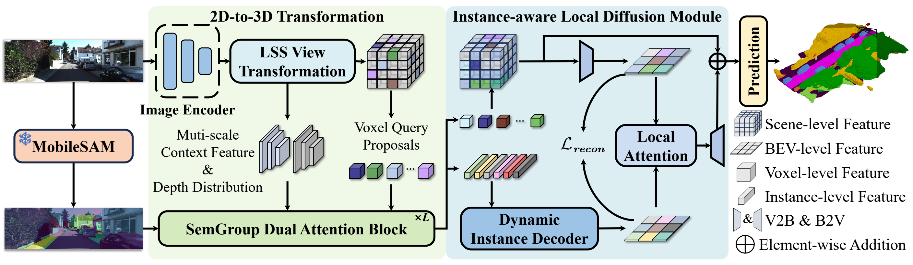
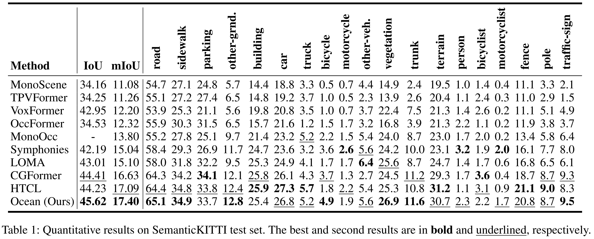
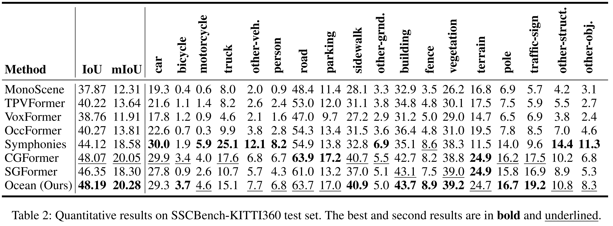
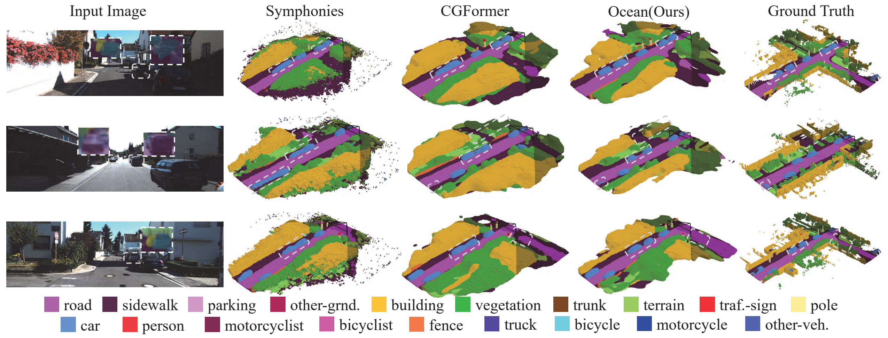

# Ocean: Towards 3D Object-Centric Feature Learning for Semantic Scene Completion

**AAAI 2026**

[](https://arxiv.org/abs/2511.13031) [](https://ocean-ssc.github.io/)


## Abstract

Vision-based 3D Semantic Scene Completion (SSC) has received growing attention due to its potential in autonomous driving. While most existing approaches follow an ego-centric paradigm by aggregating and diffusing features over the entire scene, they often overlook fine-grained object-level details, leading to semantic and geometric ambiguities, especially in complex environments. To address this limitation, we propose Ocean, an object-centric prediction framework that decomposes the scene into individual object instances to enable more accurate semantic occupancy prediction. Specifically, we first employ a lightweight segmentation model, MobileSAM, to extract instance masks from the input image. Then, we introduce a 3D Semantic Group Attention module that leverages linear attention to aggregate object-centric features in 3D space. To handle segmentation errors and missing instances, we further design a Global Similarity-Guided Attention module that leverages segmentation features for global interaction. Finally, we propose an Instance-aware Local Diffusion module that improves instance features through a generative process and subsequently refines the scene representation in the BEV space. Extensive experiments on the SemanticKITTI and SSCBench-KITTI360 benchmarks demonstrate that Ocean achieves state-of-the-art performance, with mIoU scores of 17.40 and 20.28, respectively.

## Overview



Ocean is an object-centric framework for monocular semantic scene completion. It uses MobileSAM instance priors to guide 3D feature learning through the following components:

- **3D Semantic Group Attention (SGA3D):** aggregates object-centric features using instance grouping and depth similarity.
- **Global Similarity-Guided Attention (GSGA):** uses segmentation features for global interaction to address mask errors and missing instances.
- **Instance-aware Local Diffusion (ILD):** reconstructs instance-aware BEV features and refines the scene representation through local attention.

## Experimental Results

### SemanticKITTI



### SSCBench-KITTI360



### Qualitative Results



## Code Release Status

- [x] Paper and project page
- [x] Framework overview and experimental results
- [ ] Code release
- [ ] Model release
- [ ] Implementation and usage instructions

## Citation

If you find this work useful, please consider citing:

```bibtex
@inproceedings{wang2026towards,
  title={Towards 3D object-centric feature learning for semantic scene completion},
  author={Wang, Weihua and Cui, Yubo and Lin, Xiangru and Li, Zhiheng and Fang, Zheng},
  booktitle={Proceedings of the AAAI Conference on Artificial Intelligence},
  volume={40},
  number={12},
  pages={10136--10144},
  year={2026}
}
```

